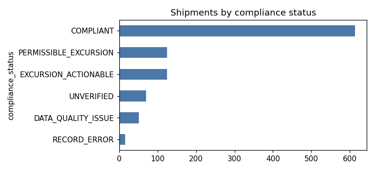
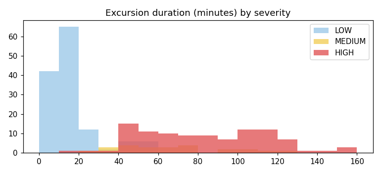
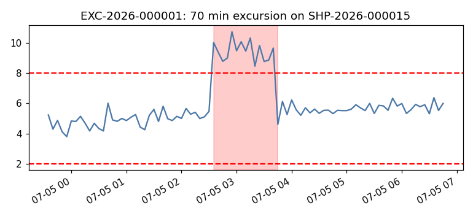
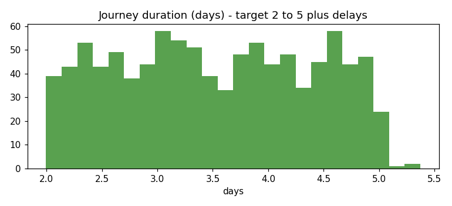

# Dataset profile (generated 2026-11-01)

Everything below is computed from the database produced by `python run.py all` (seed 20261022).

## Volume
- Shipments: **1,000** | Containers: **300** | Sensors: **600** | Readings: **2,027,840** (5-minute interval, temperature + humidity)
- Journey length (valid shipments): min 2.00 d, median 3.49 d, max 5.37 d (2-5 day plan plus route delays)
- Container reuse: 1-7 shipments per container (mean 3.3); no overlaps (see validation report)

## Injected scenario mix (shipment level)
| scenario    |   count |   share_% |
|:------------|--------:|----------:|
| NORMAL      |     600 |        60 |
| BRIEF       |     120 |        12 |
| PROLONGED   |     100 |        10 |
| DROPOUT     |      70 |         7 |
| CALIBRATION |      40 |         4 |
| ROUTE_DELAY |      40 |         4 |
| MULTI       |      30 |         3 |

Edge-case flags (on otherwise normal shipments): PHYS=12, DBD=8, MISMATCH=8, TRAP=10, BOUNDARY=10

## Products and policies
| product_name         |   version |   min_temperature |   max_temperature |   min_humidity |   max_humidity |   max_excursion_minutes | effective_from      |
|:---------------------|----------:|------------------:|------------------:|---------------:|---------------:|------------------------:|:--------------------|
| Vaccine A            |         1 |                 2 |                 8 |             30 |             60 |                      15 | 2026-01-01 00:00:00 |
| Vaccine A            |         2 |                 2 |                 8 |             30 |             60 |                      10 | 2026-09-15 00:00:00 |
| Insulin B            |         1 |                 2 |                 8 |             30 |             65 |                      20 | 2026-01-01 00:00:00 |
| Insulin B            |         2 |                 2 |                 8 |             30 |             65 |                      15 | 2026-09-15 00:00:00 |
| Frozen Biologic C    |         1 |               -25 |               -15 |             20 |             50 |                      10 | 2026-01-01 00:00:00 |
| Frozen Biologic C    |         2 |               -25 |               -15 |             20 |             50 |                       5 | 2026-09-15 00:00:00 |
| Tablets D            |         1 |                15 |                25 |             30 |             60 |                      60 | 2026-01-01 00:00:00 |
| Tablets D            |         2 |                15 |                25 |             30 |             60 |                      55 | 2026-09-15 00:00:00 |
| Dairy Product E      |         1 |                 1 |                 6 |             40 |             80 |                      30 | 2026-01-01 00:00:00 |
| Dairy Product E      |         2 |                 1 |                 6 |             40 |             80 |                      25 | 2026-09-15 00:00:00 |
| Diagnostic Reagent F |         1 |                 2 |                 8 |             30 |             60 |                      20 | 2026-01-01 00:00:00 |
| Diagnostic Reagent F |         2 |                 2 |                 8 |             30 |             60 |                      15 | 2026-09-15 00:00:00 |

Limits are illustrative, not universal pharmaceutical limits.

## Reading values
| sensor_type   |   mn |    av |   mx |       n |
|:--------------|-----:|------:|-----:|--------:|
| HUMIDITY      |  -20 | 46.29 |  250 | 1013766 |
| TEMPERATURE   | -100 |  2.97 |  250 | 1014074 |

(Values outside the physical range -50..60 C / 0..100 %RH are the deliberately injected invalid readings.)

## Compliance outcome per shipment
| compliance_status     |   count |   share_% |
|:----------------------|--------:|----------:|
| COMPLIANT             |     614 |      61.4 |
| PERMISSIBLE_EXCURSION |     125 |      12.5 |
| EXCURSION_ACTIONABLE  |     124 |      12.4 |
| UNVERIFIED            |      70 |       7   |
| DATA_QUALITY_ISSUE    |      51 |       5.1 |
| RECORD_ERROR          |      16 |       1.6 |

## Excursions
- Total 257; temperature 192, humidity 65; HIGH direction 173, LOW 84
- Duration minutes: median 40, p90 107, max 160; actionable 124 (48%)
| severity   |   count |   share_% |
|:-----------|--------:|----------:|
| LOW        |     133 |      51.8 |
| HIGH       |     100 |      38.9 |
| MEDIUM     |      24 |       9.3 |

## Monitoring gaps
- 137 gaps; 125 over the 15-minute tolerance; missing intervals per gap: min 2, median 12, max 24; total unverified time 8,260 min

## Shipment issues
| issue_type                |   count |   share_% |
|:--------------------------|--------:|----------:|
| ROUTE_DELAY               |      55 |      31.2 |
| CALIBRATION_EXPIRED       |      50 |      28.4 |
| LATE_ARRIVAL              |      37 |      21   |
| PHYSICAL_RANGE_VIOLATION  |      18 |      10.2 |
| POLICY_MISMATCH           |       8 |       4.5 |
| DELIVERY_BEFORE_DEPARTURE |       8 |       4.5 |

## Route delays
- Delayed shipments (>60 min late): 55; delay minutes median 550, max 820

## Workflow records
| corrective_action_status   |   count |   share_% |
|:---------------------------|--------:|----------:|
| VERIFIED                   |     118 |      52.7 |
| RESOLVED                   |      35 |      15.6 |
| ASSIGNED                   |      28 |      12.5 |
| IN_PROGRESS                |      23 |      10.3 |
| OPEN                       |      20 |       8.9 |

| notification_recipient   |   count |   share_% |
|:-------------------------|--------:|----------:|
| MAINTENANCE_ENGINEER     |     225 |      34.2 |
| PLANT_OPERATOR           |     133 |      20.2 |
| QUALITY_ENGINEER         |     132 |      20.1 |
| OT_IT_ADMIN              |     113 |      17.2 |
| PRODUCTION_PLANNER       |      55 |       8.4 |

## Journey durations

