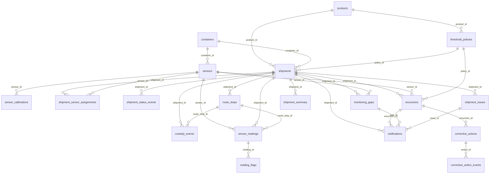

# Entity-relationship diagram

Blue = master data, green = input/transaction data, orange = engine-derived tables. Rendered natively on GitHub.

A static image is also provided: `docs/database_schema.png`. Cardinalities are listed in `business_rules.md`.
